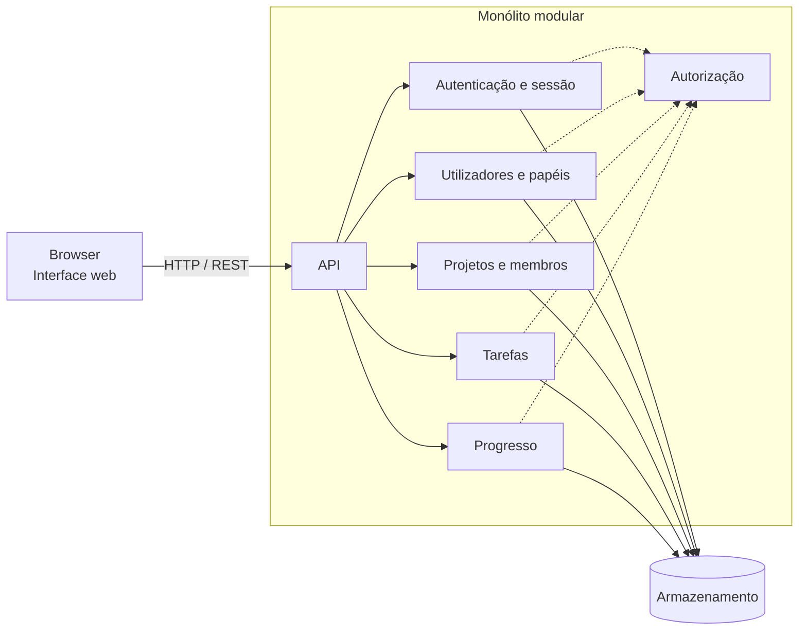

# Arquitetura — Matriz

## Estado e âmbito

Este documento regista a decisão arquitetural proposta para o MVP da Matriz, na Ficha PL 02. A decisão de **monólito modular** foi aprovada pelo utilizador e deve ser validada com o cliente, tal como os restantes pressupostos. Não escolhe linguagens, frameworks, base de dados nem alojamento. Baseia-se em [requirements.md](./requirements.md), [constraints.md](./constraints.md), [user-stories.md](./user-stories.md), [database.md](./database.md) e [openapi.yaml](../openapi.yaml).

## Contexto e fatores de decisão

- Aplicação web de gestão de projetos e tarefas, usada através de um browser.
- Escala de referência: uma equipa pequena/média, até cerca de 50 utilizadores. Não é um limite funcional confirmado.
- Sem integrações externas no MVP.
- Funcionalidades do MVP: autenticação, utilizadores e papéis, projetos e membros, tarefas e atribuição, progresso por projeto e tarefas do utilizador.
- Papéis e estados de tarefa fixos; sem múltiplas equipas nem permissões granulares.

## Abordagens consideradas

| Abordagem | Vantagens | Desvantagens | Adequação ao MVP |
|---|---|---|---|
| **Monólito tradicional** | Simples de desenvolver, executar e publicar. | Responsabilidades podem ficar entrelaçadas e difíceis de alterar isoladamente. | Viável, mas com menos separação explícita entre áreas. |
| **Monólito modular** | Uma só aplicação a publicar, com módulos e responsabilidades separados; evolui sem custo operacional adicional. | Exige disciplina para manter os limites entre módulos; partilha ciclo de publicação e armazenamento. | **Adequado:** simples para a escala prevista e com a separação pretendida. |
| **Microservices** | Publicação e escala independentes por serviço. | Complexidade operacional e de comunicação (consistência, falhas, observabilidade). | Não se justifica: sem integrações nem requisitos de escala que o compensem. |

## Decisão

Adotar um **monólito modular**: uma única aplicação implantável, internamente dividida em módulos com fronteiras claras, que comunica com o browser através de uma API REST (contrato em [openapi.yaml](../openapi.yaml)).

Justificação:

- A escala e o âmbito não exigem serviços independentes.
- Os módulos refletem a separação de responsabilidades pedida e os grupos de endpoints já definidos.
- Uma só unidade de publicação reduz operação, testes de integração e consistência de dados (por exemplo, a regra "responsável tem de ser membro do projeto" envolve vários módulos).
- Se um módulo vier a precisar de escala ou publicação independente, as fronteiras permitem extraí-lo mais tarde.

## Visão geral

## Componentes e responsabilidades

| Componente | Responsabilidades | Dados que possui | Endpoints (OpenAPI) | Requisitos |
|---|---|---|---|---|
| **Interface web** | Ecrãs do MVP (dashboard, projetos, tarefas, utilizadores e papéis) e navegação por papel; consome a API. | Nenhum | — | RF-01, RF-02 |
| **API** | Expõe o contrato REST, valida pedidos e traduz erros para os códigos do contrato (400, 401, 403, 404, 409). | Nenhum | Todos | Todos |
| **Autenticação e sessão** | Iniciar e terminar sessão com email e palavra-passe; criar e invalidar sessões no servidor; identificar o utilizador de cada pedido; mensagem genérica em falhas de login. | `Session`; credenciais de `User` (`password_hash`) | `POST /sessions`, `DELETE /sessions/current` | RF-01 |
| **Utilizadores e papéis** | Consultar utilizadores; atribuir um dos três papéis; devolver o utilizador atual. | `User` | `GET /users`, `PATCH /users/{userId}`, `GET /users/me` | RF-02, RF-03 |
| **Projetos e membros** | Criar, consultar e atualizar projetos; associar e listar membros; determinar o acesso de um utilizador a um projeto (gestor ou membro). | `Project`, `ProjectMember` | `GET/POST /projects`, `GET/PATCH /projects/{projectId}`, `GET/POST /projects/{projectId}/members` | RF-04, RF-05 |
| **Tarefas** | Criar, consultar, atualizar e atribuir tarefas; listar e filtrar por estado e responsável; listar as tarefas do utilizador; aplicar os estados fixos. | `Task` | `GET/POST /projects/{projectId}/tasks`, `GET/PATCH /projects/{projectId}/tasks/{taskId}`, `GET /users/me/tasks` | RF-06 a RF-10, RF-12 |
| **Progresso** | Calcular contagens por estado e tarefas em aberto de um projeto, a partir das tarefas atuais. Não guarda dados próprios. | Nenhum | `GET /projects/{projectId}/progress` | RF-11 |
| **Autorização** (transversal) | Aplicar as regras de acesso por papel e por projeto antes de cada operação; não revelar recursos a quem não tem acesso. | Nenhum | Todos | RF-02, RF-05, RF-09 |
| **Armazenamento** | Persistir `User`, `Session`, `Project`, `ProjectMember` e `Task` conforme [database.md](./database.md). | Todos | — | — |

## Regras de fronteira entre módulos

- Cada módulo é o único responsável pelos seus dados. Os outros módulos acedem-lhes através da interface pública do módulo, não diretamente ao armazenamento.
- **Autorização é transversal:** as regras de acesso a projetos e tarefas são avaliadas num único sítio, para evitar decisões inconsistentes. Os módulos fornecem-lhe os factos de que precisa (papel, gestor, membros).
- **Dependências previstas:** Tarefas usa Projetos (acesso e membros); Progresso usa Tarefas; Projetos usa Utilizadores (papel do gestor).
- **Dependência circular a vigiar:** a regra "não alterar o papel de quem gere projetos" faz Utilizadores consultar Projetos, e Projetos já consulta Utilizadores. Deve resolver-se com consultas através de interfaces públicas (por exemplo, "este utilizador gere projetos?"), sem partilhar estruturas internas.
- Regras que atravessam módulos (responsável tem de ser membro, gestor tem de ter papel Project Manager) são aplicadas pela aplicação, não pelas chaves estrangeiras.

## Regras de negócio com impacto arquitetural

Decisões adotadas na Ficha PL 02, a validar com o cliente:

- Cada projeto tem um único gestor, que conta implicitamente como membro.
- Terminar sessão invalida a sessão no servidor; o formato do token e a expiração estão por decidir.
- O progresso de um projeto é visível a qualquer utilizador com acesso a esse projeto.
- A resposta a pedidos de utilizadores sem acesso a um projeto devolve 404, em vez de 403, para não revelar se o recurso existe.

## Decisões pendentes

| Decisão | Notas |
|---|---|
| Linguagens, frameworks e ferramentas | Não escolhidos; a escolha tem de respeitar a arquitetura e o contrato. |
| Armazenamento | Tipo de base de dados, migrações e mecanismo de backup. O modelo lógico está em [database.md](./database.md). |
| Mecanismo de autenticação e sessão | Formato do token, expiração, renovação, recuperação de acesso, proteção contra tentativas abusivas e política de palavra-passe. |
| **Criação de contas** | Como são criadas, convidadas e desativadas as contas; as primeiras contas são um bloqueio em aberto (ver [user-stories.md](./user-stories.md)). |
| Alterações concorrentes | Como evitar perda silenciosa de alterações numa tarefa (por exemplo, um campo de versão ou data de atualização, que o modelo não tem). |
| Alcance do Admin sobre projetos | Por definir nos requisitos. |
| Origem da API e da interface | Mesma origem ou separadas; o contrato usa uma base relativa (`/`). |
| Alojamento, ambientes e publicação | Não definidos. |
| Observabilidade, backups e recuperação | Não definidos. |
| Requisitos mensuráveis | Desempenho, disponibilidade, acessibilidade e compatibilidade de browsers por acordar. |
| Segurança e privacidade | Dados pessoais, retenção, eliminação e auditoria por definir. |

## Evolução

Se o âmbito crescer (múltiplas equipas, notificações, integrações), reavaliar primeiro as fronteiras entre módulos. A extração de um módulo para um serviço próprio só deve ser considerada quando houver necessidade concreta de escala ou de publicação independente.
