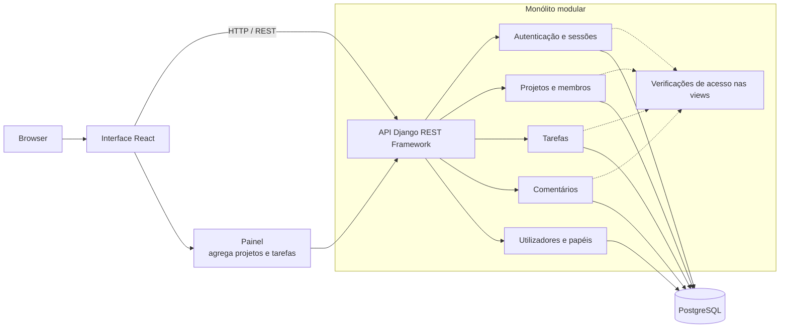

# Arquitetura — Matriz

## Estado e âmbito

Este documento regista a decisão de **monólito modular** e a stack aprovada para a implementação inicial: Python com Django e Django REST Framework no backend, React com Vite no frontend, PostgreSQL e Django ORM. Baseia-se em [requirements.md](./requirements.md), [constraints.md](./constraints.md), [user-stories.md](./user-stories.md), [database.md](./database.md) e [openapi.yaml](../openapi.yaml).

## Contexto e fatores de decisão

- Aplicação web de gestão de projetos e tarefas, usada através de um browser.
- Escala de referência: uma equipa pequena/média, até cerca de 50 utilizadores. Não é um limite funcional confirmado.
- Sem integrações externas no MVP.
- Stack inicial: Django/DRF, React/Vite, PostgreSQL e Django ORM.
- Funcionalidades implementadas: autenticação, CRUD e pesquisa de projetos, consulta de membros de projeto, tarefas com estado/prioridade e filtros, responsáveis, comentários e painel inicial. As limitações da API estão registadas em [implementation-plan.md](./implementation-plan.md).
- Papéis e estados de tarefa fixos; sem múltiplas equipas nem permissões granulares.

## Abordagens consideradas

| Abordagem | Vantagens | Desvantagens | Adequação ao MVP |
|---|---|---|---|
| **Monólito tradicional** | Simples de desenvolver, executar e publicar. | Responsabilidades podem ficar entrelaçadas e difíceis de alterar isoladamente. | Viável, mas com menos separação explícita entre áreas. |
| **Monólito modular** | Uma só aplicação a publicar, com módulos e responsabilidades separados; evolui sem custo operacional adicional. | Exige disciplina para manter os limites entre módulos; partilha ciclo de publicação e armazenamento. | **Adequado:** simples para a escala prevista e com a separação pretendida. |
| **Microservices** | Publicação e escala independentes por serviço. | Complexidade operacional e de comunicação (consistência, falhas, observabilidade). | Não se justifica: sem integrações nem requisitos de escala que o compensem. |

## Decisão

Adotar um **monólito modular**: uma única aplicação implantável, internamente dividida em módulos com fronteiras claras, que comunica com o browser através de uma API REST (contrato em [openapi.yaml](../openapi.yaml)).

Justificação:

- A escala e o âmbito não exigem serviços independentes.
- Os módulos refletem a separação de responsabilidades pedida e os grupos de endpoints já definidos.
- Uma só unidade de publicação reduz operação, testes de integração e consistência de dados (por exemplo, a regra "responsável tem de ser membro do projeto" envolve vários módulos).
- Se um módulo vier a precisar de escala ou publicação independente, as fronteiras permitem extraí-lo mais tarde.

## Visão geral

## Componentes e responsabilidades

| Componente | Responsabilidades | Dados que possui | Endpoints (OpenAPI) | Requisitos |
|---|---|---|---|---|
| **Interface web** | Ecrãs de autenticação, painel, projetos e tarefas; consome a API e sincroniza as vistas após operações confirmadas. | Estado de apresentação | — | RF-01, RF-04, RF-06 a RF-15 |
| **API** | Django REST Framework valida pedidos e devolve erros de validação, `detail` ou conflito conforme a operação. As listagens devolvem arrays sem paginação. | Nenhum | Rotas documentadas em [openapi.yaml](../openapi.yaml) | RF-01 a RF-15 |
| **Autenticação e sessão** | Autenticação por email/palavra-passe, sessão Django no servidor e proteção CSRF para operações mutáveis. | `User`; `django_session` | `GET /csrf/`, `POST /sessions/`, `DELETE /sessions/current/` | RF-01 |
| **Utilizadores e papéis** | Devolver o utilizador autenticado e o respetivo papel. Não existe API da aplicação para listar utilizadores ou alterar papéis. | `User` | `GET /users/me/` | RF-02, RF-03 |
| **Projetos e membros** | CRUD e pesquisa de projetos; verificar acesso; consultar membros ativos e o gestor do projeto. A API não cria nem remove membros. | `Project`, `ProjectMember` | `/projects/`, `/projects/{projectId}/`, `GET /projects/{projectId}/members/` | RF-04, RF-05, RF-13 |
| **Tarefas** | CRUD, filtros por estado/prioridade/responsável, atribuições e atualização restrita de estado por Developer atribuído. | `Task`, `TaskAssignee` | `/projects/{projectId}/tasks/`, detalhe, `/assignees/` | RF-06 a RF-10, RF-12 |
| **Comentários** | Criar e listar por ordem de criação; o servidor define autor e data. | `Comment` | `/projects/{projectId}/tasks/{taskId}/comments/` | RF-14 |
| **Painel** | Carregar projetos e tarefas pelas rotas existentes e calcular no browser contagens por estado e tarefas atribuídas ao utilizador. | Estado de apresentação | Sem endpoint próprio | RF-11, RF-12, RF-15 |
| **Django Admin** | Interface administrativa disponibilizada pelo Django, fora do contrato REST da aplicação. | Modelos registados no Admin | `/admin/` | Fora do fluxo da API |
| **Autorização** (transversal) | As views limitam consultas ao projeto acessível e verificam papel/gestor nas operações que alteram dados. | Nenhum | Aplicada nas rotas de projetos, tarefas e comentários | RF-02, RF-05, RF-09, RF-14 |
| **Armazenamento** | PostgreSQL, acedido pelo Django ORM; persistir entidades, sessões e migrations. | Todos | — | — |

## Regras de fronteira entre módulos

- As apps Django organizam responsabilidades, mas ainda não formam fronteiras isoladas: há dependências diretas entre modelos e views de `accounts`, `projects`, `tasks` e `comments`.
- As verificações de acesso são feitas nas views por consultas limitadas ao projeto e helpers de autorização. A implementação não usa uma única permission class global para todos os endpoints.
- **Dependências atuais:** Tarefas consulta Projetos e Utilizadores para acesso/elegibilidade; Comentários reutiliza a consulta de tarefa autorizada; o Painel obtém projetos e tarefas através da API e calcula as contagens no frontend.
- A classe `StrictSerializer` partilhada em `apps.common` rejeita campos desconhecidos nos serializers de escrita que a utilizam.

## Regras e escolhas registadas

**Comportamento implementado:** sessões Django no servidor; estados `TODO`, `IN_PROGRESS`, `DONE`; prioridades `LOW`, `MEDIUM`, `HIGH` com defaults `TODO` e `MEDIUM`; proteção CSRF; e eliminação em cascata de dados dependentes de projetos e tarefas. A listagem de comentários está ordenada por data e identificador.

**Pressupostos de produto ainda por validar:** cada projeto tem um gestor único que conta implicitamente como membro; vários responsáveis podem estar associados a uma tarefa; progresso é visível a utilizadores com acesso ao projeto; e pedidos a projetos sem acesso devolvem 404. As regras propostas por papel constam de [constraints.md](./constraints.md) e ainda não são decisões aprovadas.

## Funcionalidades ainda não implementadas

Por decisão do utilizador, RF-03 (gestão de papéis pela aplicação) e RF-05 (associação de membros pelo gestor) ficam documentados como pendentes, sem alargar o âmbito desta entrega. Também não existem endpoints REST para tarefas pessoais, progresso do projeto ou painel; o frontend agrega dados de projetos e tarefas pelas rotas disponíveis.

## Decisões pendentes

| Decisão | Notas |
|---|---|
| Política de sessão | Duração, renovação e expiração das sessões Django. |
| **Criação de contas** | Como são criadas, convidadas e desativadas as contas; as primeiras contas são um bloqueio em aberto (ver [user-stories.md](./user-stories.md)). |
| Comentários | Limites de conteúdo, ordenação, edição/remoção e retenção. |
| Pesquisa | Correspondência por nome, sensibilidade a maiúsculas/acentos e comportamento sem resultados. |
| Alterações concorrentes | Como evitar perda silenciosa de alterações numa tarefa (por exemplo, um campo de versão ou data de atualização, que o modelo não tem). |
| Alcance do Admin sobre projetos | Por definir nos requisitos. |
| Proteção CSRF e origens | Configuração de produção para o cookie de sessão, token CSRF e pedidos de origem cruzada. |
| Alojamento, ambientes e publicação | Não definidos. |
| Observabilidade, backups e recuperação | Não definidos. |
| Requisitos mensuráveis | Desempenho, disponibilidade, acessibilidade e compatibilidade de browsers por acordar. |
| Segurança e privacidade | Dados pessoais, retenção, eliminação e auditoria por definir. |

## Evolução

Se o âmbito crescer (múltiplas equipas, notificações, integrações), reavaliar primeiro as fronteiras entre módulos. A extração de um módulo para um serviço próprio só deve ser considerada quando houver necessidade concreta de escala ou de publicação independente.
