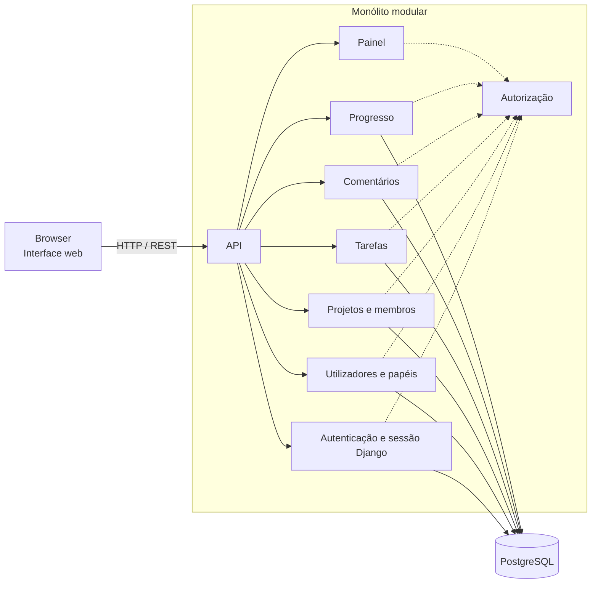

# Arquitetura — Matriz

## Estado e âmbito

Este documento regista a decisão de **monólito modular** e a stack aprovada para a implementação inicial: Python com Django e Django REST Framework no backend, React com Vite no frontend, PostgreSQL e Django ORM. Baseia-se em [requirements.md](./requirements.md), [constraints.md](./constraints.md), [user-stories.md](./user-stories.md), [database.md](./database.md) e [openapi.yaml](../openapi.yaml).

## Contexto e fatores de decisão

- Aplicação web de gestão de projetos e tarefas, usada através de um browser.
- Escala de referência: uma equipa pequena/média, até cerca de 50 utilizadores. Não é um limite funcional confirmado.
- Sem integrações externas no MVP.
- Stack inicial: Django/DRF, React/Vite, PostgreSQL e Django ORM.
- Funcionalidades desta fase: autenticação, projetos e membros, tarefas com estado/prioridade, múltiplos responsáveis, comentários, pesquisa, progresso e painel inicial.
- Papéis e estados de tarefa fixos; sem múltiplas equipas nem permissões granulares.

## Abordagens consideradas

| Abordagem | Vantagens | Desvantagens | Adequação ao MVP |
|---|---|---|---|
| **Monólito tradicional** | Simples de desenvolver, executar e publicar. | Responsabilidades podem ficar entrelaçadas e difíceis de alterar isoladamente. | Viável, mas com menos separação explícita entre áreas. |
| **Monólito modular** | Uma só aplicação a publicar, com módulos e responsabilidades separados; evolui sem custo operacional adicional. | Exige disciplina para manter os limites entre módulos; partilha ciclo de publicação e armazenamento. | **Adequado:** simples para a escala prevista e com a separação pretendida. |
| **Microservices** | Publicação e escala independentes por serviço. | Complexidade operacional e de comunicação (consistência, falhas, observabilidade). | Não se justifica: sem integrações nem requisitos de escala que o compensem. |

## Decisão

Adotar um **monólito modular**: uma única aplicação implantável, internamente dividida em módulos com fronteiras claras, que comunica com o browser através de uma API REST (contrato em [openapi.yaml](../openapi.yaml)).

Justificação:

- A escala e o âmbito não exigem serviços independentes.
- Os módulos refletem a separação de responsabilidades pedida e os grupos de endpoints já definidos.
- Uma só unidade de publicação reduz operação, testes de integração e consistência de dados (por exemplo, a regra "responsável tem de ser membro do projeto" envolve vários módulos).
- Se um módulo vier a precisar de escala ou publicação independente, as fronteiras permitem extraí-lo mais tarde.

## Visão geral

## Componentes e responsabilidades

| Componente | Responsabilidades | Dados que possui | Endpoints (OpenAPI) | Requisitos |
|---|---|---|---|---|
| **Interface web** | Ecrãs de autenticação, painel, projetos, tarefas, comentários e utilizadores/papéis; consome a API. | Nenhum | — | RF-01 a RF-15 |
| **API** | Django REST Framework expõe o contrato REST, valida pedidos e traduz erros para os códigos do contrato (400, 401, 403, 404, 409). | Nenhum | Todos | Todos |
| **Autenticação e sessão** | Django autentica por email e palavra-passe; as sessões são persistidas pelo backend de sessões de Django e invalidadas no logout. A API usa cookie de sessão e proteção CSRF. | `User`; `django_session` | `GET /csrf`, `POST /sessions`, `DELETE /sessions/current` | RF-01 |
| **Utilizadores e papéis** | Consultar utilizadores; atribuir um dos três papéis; devolver o utilizador atual. | `User` | `GET /users`, `PATCH /users/{userId}`, `GET /users/me` | RF-02, RF-03 |
| **Projetos e membros** | Criar, consultar, pesquisar, atualizar e eliminar projetos; gerir membros e determinar acesso. | `Project`, `ProjectMember` | `GET/POST /projects`, `GET/PATCH/DELETE /projects/{projectId}`, `/projects/{projectId}/members` e utilizadores elegíveis | RF-04, RF-05, RF-13 |
| **Tarefas** | CRUD de tarefas; estado e prioridade; múltiplos responsáveis; filtros; tarefas do utilizador. | `Task`, `TaskAssignee` | `/projects/{projectId}/tasks`, `/projects/{projectId}/tasks/{taskId}`, `/projects/{projectId}/tasks/{taskId}/assignees`, `GET /users/me/tasks` | RF-06 a RF-10, RF-12 |
| **Comentários** | Criar e listar comentários; atribuir autor autenticado e data no servidor. | `Comment` | `GET/POST /projects/{projectId}/tasks/{taskId}/comments` | RF-14 |
| **Progresso e painel** | Calcular contagens atuais por estado e fornecer os projetos acessíveis com as respetivas contagens. | Nenhum | `GET /projects/{projectId}/progress`, `GET /dashboard` | RF-11, RF-15 |
| **Autorização** (transversal) | Aplicar as regras de acesso por papel e por projeto antes de cada operação; não revelar recursos a quem não tem acesso. | Nenhum | Todos | RF-02, RF-05, RF-09, RF-14 |
| **Armazenamento** | PostgreSQL, acedido pelo Django ORM; persistir entidades de domínio e tabelas de sessão/migração do framework. | Todos | — | — |

## Regras de fronteira entre módulos

- Cada módulo é o único responsável pelos seus dados. Os outros módulos acedem-lhes através da interface pública do módulo, não diretamente ao armazenamento.
- **Autorização é transversal:** as regras de acesso a projetos e tarefas são avaliadas num único sítio, para evitar decisões inconsistentes. Os módulos fornecem-lhe os factos de que precisa (papel, gestor, membros).
- **Dependências previstas:** Tarefas usa Projetos (acesso, membros e elegibilidade); Comentários usa Tarefas e Autorização; Progresso/Painel usa Projetos e Tarefas; Projetos usa Utilizadores (papel do gestor).
- **Dependência circular a vigiar:** a regra "não alterar o papel de quem gere projetos" faz Utilizadores consultar Projetos, e Projetos já consulta Utilizadores. Deve resolver-se com consultas através de interfaces públicas (por exemplo, "este utilizador gere projetos?"), sem partilhar estruturas internas.
- Regras que atravessam módulos (responsável tem de ser membro, gestor tem de ter papel Project Manager) são aplicadas pela aplicação, não pelas chaves estrangeiras.

## Regras e escolhas registadas

**Confirmado para a estrutura inicial:** Django server-side sessions; os códigos de estado `TODO`, `IN_PROGRESS`, `DONE`; os códigos de prioridade `LOW`, `MEDIUM`, `HIGH` com defaults `TODO` e `MEDIUM`; e eliminação em cascata de dados dependentes de projetos e tarefas. Os cookies de sessão usam proteção CSRF.

**Pressupostos de produto ainda por validar:** cada projeto tem um gestor único que conta implicitamente como membro; vários responsáveis podem estar associados a uma tarefa; progresso é visível a utilizadores com acesso ao projeto; e pedidos a projetos sem acesso devolvem 404. As regras propostas por papel constam de [constraints.md](./constraints.md) e ainda não são decisões aprovadas.

## Decisões pendentes

| Decisão | Notas |
|---|---|
| Política de sessão | Duração, renovação e expiração das sessões Django. |
| **Criação de contas** | Como são criadas, convidadas e desativadas as contas; as primeiras contas são um bloqueio em aberto (ver [user-stories.md](./user-stories.md)). |
| Comentários | Limites de conteúdo, ordenação, edição/remoção e retenção. |
| Pesquisa | Correspondência por nome, sensibilidade a maiúsculas/acentos e comportamento sem resultados. |
| Alterações concorrentes | Como evitar perda silenciosa de alterações numa tarefa (por exemplo, um campo de versão ou data de atualização, que o modelo não tem). |
| Alcance do Admin sobre projetos | Por definir nos requisitos. |
| Proteção CSRF e origens | Configuração de produção para o cookie de sessão, token CSRF e pedidos de origem cruzada. |
| Alojamento, ambientes e publicação | Não definidos. |
| Observabilidade, backups e recuperação | Não definidos. |
| Requisitos mensuráveis | Desempenho, disponibilidade, acessibilidade e compatibilidade de browsers por acordar. |
| Segurança e privacidade | Dados pessoais, retenção, eliminação e auditoria por definir. |

## Evolução

Se o âmbito crescer (múltiplas equipas, notificações, integrações), reavaliar primeiro as fronteiras entre módulos. A extração de um módulo para um serviço próprio só deve ser considerada quando houver necessidade concreta de escala ou de publicação independente.
