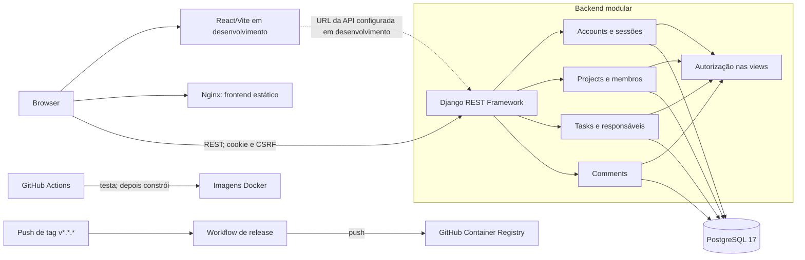

# Arquitetura — Matriz

## Estado e decisões confirmadas

O Matriz é um monólito modular: a API Django contém os módulos de contas, projetos, tarefas e comentários; o frontend React é uma aplicação cliente separada, compilada como ficheiros estáticos. PostgreSQL é a base de dados relacional. Não há deployment de produção configurado.

| Área | Decisão/versão implementada |
|---|---|
| Backend | Python 3.15.1 na imagem; Django 6.1.3, Django REST Framework 3.18.3 |
| Frontend | Node 22.23.4 na imagem de build, React 19.3.1, Vite 8.3.5 |
| Dados | PostgreSQL 17, acedido pelo Django ORM |
| Autenticação | Sessões Django server-side, cookie `sessionid`, proteção CSRF |
| Runtime frontend | Build Vite servido por Nginx 1.29.3 |
| Contrato HTTP | OpenAPI 3.1 em [`openapi.yaml`](../openapi.yaml), versão `0.1.0-rc.4` |

A utilização local também é documentada para Python 3.12–3.15 e Node.js 20.19+ ou 22.12+. Versões de produção/deployment, disponibilidade e escala não estão definidas.

## Componentes e comunicação

O painel agrega dados no frontend a partir dos endpoints disponíveis. Não existem endpoints REST próprios de dashboard, progresso do projeto ou tarefas pessoais.

## Persistência e autenticação

- PostgreSQL 17 e Django ORM; migrations são aplicadas explicitamente.
- Entidades persistidas: utilizadores, projetos, membros, tarefas, responsáveis e comentários. Sessões usam `django.contrib.sessions`.
- Login por email e palavra-passe. O servidor guarda a sessão e invalida-a no logout. Pedidos mutáveis do browser usam CSRF.
- Papéis: `ADMIN`, `PROJECT_MANAGER`, `DEVELOPER`; estados: `TODO`, `IN_PROGRESS`, `DONE`; prioridades: `LOW`, `MEDIUM`, `HIGH`.
- O Admin tem leitura global de projetos, tarefas e comentários, sem escrita em projetos/tarefas nem criação de comentários. A API limita recursos não acessíveis e devolve 404.

## Docker e Compose

- [`compose.yaml`](../compose.yaml) executa `db`, `backend` e `frontend`; health checks ordenam o arranque. Portas locais: PostgreSQL 5432, API 8001, frontend 5174. A base de dados persiste num volume Docker.
- [`backend/Dockerfile`](../backend/Dockerfile) tem targets separados: `development` usa Django `runserver` e é selecionado pelo Compose local; `production` usa Gunicorn. Ambos executam como utilizador não-root.
- [`frontend/Dockerfile`](../frontend/Dockerfile) compila com Node 22.23.4 e serve os assets com Nginx 1.29.3. `VITE_API_BASE_URL` é definido em build; o Dockerfile usa `http://localhost:8000/api` por omissão e o Compose de desenvolvimento substitui-o por `http://localhost:8001/api`.
- [`compose.e2e.yaml`](../compose.e2e.yaml) define uma base PostgreSQL separada e serviços isolados para Playwright `v1.56.1`; migrations e seed E2E são passos explícitos.
- O arranque não executa migrations ou seed. O `.env` é local e não deve ser versionado.

## CI e publicação

- [`.github/workflows/ci.yml`](../.github/workflows/ci.yml): em pushes para `main`/`develop` e pull requests para `main`, executa PostgreSQL 17, `manage.py check`, testes Django e testes frontend. O job `build` tem `needs: test` e só constrói/verifica as imagens backend e frontend se `test` passar; o backend usa o target `production`. Permissão: `contents: read`; credenciais de teste são placeholders.
- [`.github/workflows/release.yml`](../.github/workflows/release.yml): em push de tags `v*.*.*`, usa `GITHUB_TOKEN` com `packages: write`, gera tags SemVer e publica `ghcr.io/simcampos/matriz-api` a partir do target `production`, além de `ghcr.io/simcampos/matriz-frontend`.
- Este pipeline publica imagens; não executa deployment. Hosting, URL pública da API e configuração de produção permanecem por definir.

## API e limites conhecidos

As 17 rotas REST e os respetivos métodos descritos em [`openapi.yaml`](../openapi.yaml) correspondem às rotas Django implementadas. O Admin Django em `/admin/` não faz parte do contrato REST. As listas não têm paginação. Gestão/criação de contas, política de expiração de sessão, requisitos de segurança/privacidade e deployment de produção continuam por definir.

O `info.version` do OpenAPI está alinhado com o candidato do produto `0.1.0-rc.4`; não foi criada uma tag nem publicada uma release com esta versão.
