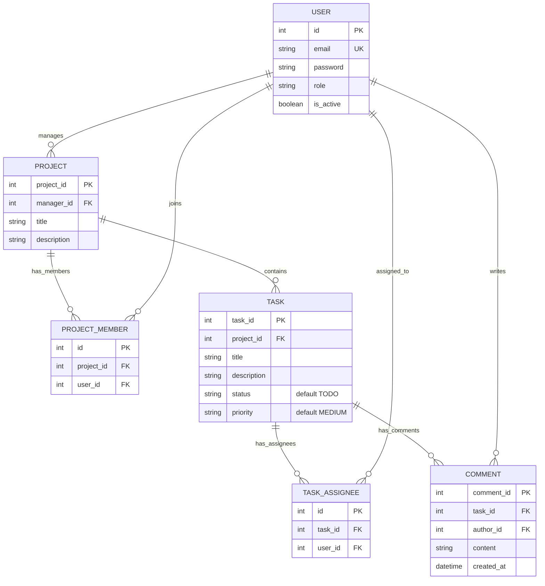

# Modelo de dados — Matriz

## Âmbito

Este é o modelo de dados aprovado para a estrutura inicial e representa autenticação e papéis, projetos e membros, tarefas com estado e prioridade, múltiplos responsáveis, comentários e consulta do progresso. Os pressupostos de produto ainda não confirmados estão identificados abaixo.

Não são incluídas entidades para equipas, histórico de alterações, anexos ou relatórios, que permanecem fora do âmbito atual. Comentários exigem persistência própria para conservar conteúdo, autor e data. A sessão é modelada porque terminar sessão exige invalidação no servidor (US-01).

## Entidades e atributos essenciais

| Entidade | Atributos | Descrição |
|---|---|---|
| **User** | `id` (PK), `email` (único), `password` (hash Django), `role`, `is_active` | Utilizador personalizado Django, credencial codificada com os hashers do Django, papel e condição da conta. |
| **Project** | `id` (PK), `manager_id` (FK → User), `title` (3–100 caracteres), `description` (opcional, até 1000 caracteres) | Projeto e Project Manager responsável. O gestor é protegido contra eliminação enquanto gerir projetos. Os limites refletem a implementação atual e carecem de confirmação do cliente. |
| **ProjectMember** | `id` (PK), `project_id` (FK → Project), `user_id` (FK → User) | Associação de um utilizador a um projeto. Restrição única composta em `project_id`, `user_id`; a eliminação do projeto ou utilizador remove a associação. |
| **Task** | `id` (PK), `project_id` (FK → Project), `title` (3–150 caracteres), `description` (opcional, até 2000 caracteres), `status` (default `TODO`), `priority` (default `MEDIUM`) | Tarefa pertencente a um projeto, com estado e prioridade. A eliminação do projeto remove as tarefas. |
| **TaskAssignee** | `id` (PK), `task_id` (FK → Task), `user_id` (FK → User) | Relação muitos-para-muitos entre tarefas e responsáveis; restrição única composta em `task_id`, `user_id` impede duplicados. Apenas membros ativos do projeto ou o gestor são elegíveis. |
| **Comment** | `id` (PK), `task_id` (FK → Task), `author_id` (FK → User), `content` (1–2000 caracteres), `created_at` | Comentário numa tarefa, com autor autenticado e data de criação atribuídos pelo servidor. O conteúdo não pode ser só espaços. A eliminação da tarefa remove comentários; o autor é protegido contra eliminação. |
| **Session** | Tabela `django_session`, gerida por `django.contrib.sessions` | Sessões servidor-side persistidas pela aplicação Django e invalidadas no logout. Não existe modelo de domínio `Session` próprio. |

O papel (`role`) é um de `ADMIN`, `PROJECT_MANAGER` ou `DEVELOPER`, apresentado na interface como Admin, Project Manager ou Developer. O estado usa os códigos `TODO`, `IN_PROGRESS` e `DONE`, por omissão `TODO`; a interface pode apresentá-los em português. A prioridade usa `LOW`, `MEDIUM` e `HIGH`, por omissão `MEDIUM`. Estes valores são escolhas aprovadas para a estrutura inicial e ficam restringidos no modelo e pela base de dados.

## Relacionamentos e cardinalidades

- **User — Project (gestão):** um utilizador pode gerir zero ou vários projetos; cada projeto tem exatamente um Project Manager responsável.
- **Project — ProjectMember:** um projeto pode ter zero ou vários registos de associação; cada registo pertence a exatamente um projeto.
- **User — ProjectMember:** um utilizador pode estar associado a zero ou vários projetos; cada registo de associação refere-se a exatamente um utilizador. Em conjunto, `ProjectMember` representa a relação muitos-para-muitos entre utilizadores e projetos.
- **Project — Task:** um projeto pode conter zero ou várias tarefas; cada tarefa pertence a exatamente um projeto.
- **Task — TaskAssignee — User:** uma tarefa pode ter zero ou vários responsáveis; um utilizador pode ser responsável por zero ou várias tarefas. A cardinalidade mínima e a elegibilidade dos responsáveis ainda precisam de decisão.
- **Task — Comment:** uma tarefa pode ter zero ou vários comentários; cada comentário pertence a exatamente uma tarefa.
- **User — Comment:** um utilizador pode escrever zero ou vários comentários; cada comentário tem exatamente um autor.
- **User — Session:** Django gere sessões autenticadas na tabela `django_session`; o identificador do utilizador é guardado no payload de sessão do framework.

O resumo de progresso é calculado a partir das tarefas de cada projeto, agrupadas por `status`; a proposta atual define tarefas em aberto como as que não estão `DONE`. Não requer uma entidade própria.

As FKs de `Task.project`, `ProjectMember.project`, `ProjectMember.user`, `TaskAssignee.task`, `TaskAssignee.user` e `Comment.task` usam eliminação em cascata. `Project.manager` e `Comment.author` usam `PROTECT` para preservar gestores e autoria. Esta política foi aprovada para a estrutura inicial.

## Regras e pressupostos a confirmar

- Cada projeto tem um único gestor responsável (proposta adotada na Ficha PL 02, a validar com o cliente). Não está decidido se pode haver vários Project Managers com poderes de gestão sobre o mesmo projeto.
- O Project Manager responsável conta implicitamente como membro: tem acesso ao projeto, aparece na lista de membros e pode ser responsável por tarefas, sem registo em `ProjectMember`. Os restantes membros obtêm acesso através de `ProjectMember`. O alcance de acesso do Admin ainda não está definido.
- `Project.manager_id` tem de referir um utilizador com papel Project Manager. A alteração do papel de um utilizador que gere projetos para outro papel é recusada. Esta regra tem de ser verificada pela aplicação, pois não fica garantida pelas chaves estrangeiras.
- Um utilizador tem um único papel principal. A acumulação de papéis não está definida.
- Cada responsável tem de ser membro ativo do projeto ou o gestor; esta regra confirmada para a implementação envolve `Task`, `TaskAssignee`, `ProjectMember` e `Project.manager_id` e não fica garantida apenas pelas chaves estrangeiras.
- O âmbito exige vários responsáveis; a cardinalidade mínima e se um projeto pode ter tarefas sem responsáveis carecem de confirmação.
- Títulos de projetos e tarefas não podem estar vazios ou conter apenas espaços. Para projetos, a implementação atual limita o título a 3–100 caracteres e a descrição a 1000; para tarefas, o título tem entre 3 e 150 caracteres e a descrição opcional tem no máximo 2000. Os limites de projeto ainda carecem de confirmação do cliente.
- Os códigos de estado e prioridade foram escolhidos para a implementação inicial; “TODO” e “MEDIUM” são os valores por omissão.
- O conteúdo dos comentários tem entre 1 e 2000 caracteres e não pode ser só espaços; a ordenação é cronológica ascendente. A possibilidade de edição/remoção e a retenção estão por definir. `author_id` e `created_at` são atribuídos pelo servidor, não escolhidos pelo cliente.
- A eliminação em cascata de projetos/tarefas remove respetivamente os dados dependentes descritos acima.
- `is_active` permite distinguir contas ativas, conforme a história de autenticação. O processo de criação, convite, desativação e remoção de utilizadores permanece por definir.
- `password` contém exclusivamente a representação codificada pelo Django; nunca guardar a palavra-passe em texto simples. As sessões usam `django.contrib.sessions`; a política de expiração continua por definir.
- Assume-se uma equipa inicial. Uma entidade `Team` só será necessária se o âmbito passar a incluir múltiplas equipas.

## Diagrama ER

