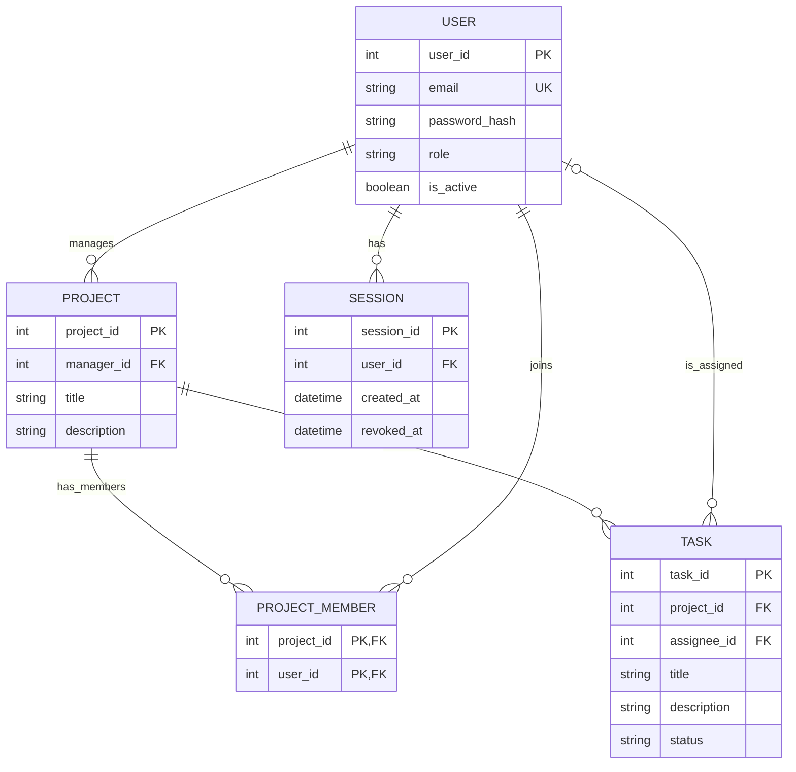

# Modelo de dados — Matriz

## Âmbito

Este modelo representa os dados necessários para o MVP: autenticação e papéis, projetos, associação de membros a projetos, tarefas, atribuição e consulta do progresso. É uma proposta alinhada com [requirements.md](./requirements.md) e [user-stories.md](./user-stories.md); os pressupostos ainda não confirmados estão identificados abaixo.

Não são incluídas entidades para equipas, histórico de alterações, comentários, anexos ou relatórios. Não fazem parte do âmbito atual ou podem ser tratados sem persistência própria no MVP. A sessão é modelada porque terminar sessão exige invalidação no servidor (US-01).

## Entidades e atributos essenciais

| Entidade | Atributos | Descrição |
|---|---|---|
| **User** | `user_id` (PK), `email` (único), `password_hash`, `role`, `is_active` | Conta de utilizador, credencial protegida, papel e condição da conta. |
| **Project** | `project_id` (PK), `manager_id` (FK → User), `title`, `description` (opcional) | Projeto e Project Manager responsável. |
| **ProjectMember** | `project_id` (PK, FK → Project), `user_id` (PK, FK → User) | Associação de um utilizador a um projeto. A chave primária composta impede associações duplicadas. |
| **Task** | `task_id` (PK), `project_id` (FK → Project), `assignee_id` (FK opcional → User), `title`, `description` (opcional), `status` | Tarefa pertencente a um projeto e, opcionalmente, atribuída a um utilizador. |
| **Session** | `session_id` (PK), `user_id` (FK → User), `created_at`, `revoked_at` (opcional) | Sessão autenticada de um utilizador. Terminar sessão preenche `revoked_at` e os pedidos seguintes com essa sessão são recusados. Formato do token e expiração por definir. |

O papel (`role`) é um de `Admin`, `Project Manager` ou `Developer`. O estado (`status`) usa o conjunto fixo proposto: `Por fazer`, `Em progresso` ou `Concluída`. Estes valores são atributos restringidos, não entidades separadas.

## Relacionamentos e cardinalidades

- **User — Project (gestão):** um utilizador pode gerir zero ou vários projetos; cada projeto tem exatamente um Project Manager responsável.
- **Project — ProjectMember:** um projeto pode ter zero ou vários registos de associação; cada registo pertence a exatamente um projeto.
- **User — ProjectMember:** um utilizador pode estar associado a zero ou vários projetos; cada registo de associação refere-se a exatamente um utilizador. Em conjunto, `ProjectMember` representa a relação muitos-para-muitos entre utilizadores e projetos.
- **Project — Task:** um projeto pode conter zero ou várias tarefas; cada tarefa pertence a exatamente um projeto.
- **User — Task (atribuição):** um utilizador pode ser responsável por zero ou várias tarefas; cada tarefa tem zero ou um responsável.
- **User — Session:** um utilizador pode ter zero ou várias sessões; cada sessão pertence a exatamente um utilizador.

O resumo de progresso é calculado a partir das tarefas de cada projeto, agrupadas por `status`; tarefas em aberto são as que não estão `Concluída`, conforme proposta. Não requer uma entidade própria.

## Regras e pressupostos a confirmar

- Cada projeto tem um único gestor responsável (decisão adotada na Ficha PL 02, a validar com o cliente). Não está decidido se pode haver vários Project Managers com poderes de gestão sobre o mesmo projeto.
- O Project Manager responsável conta implicitamente como membro: tem acesso ao projeto, aparece na lista de membros e pode ser responsável por tarefas, sem registo em `ProjectMember`. Os restantes membros obtêm acesso através de `ProjectMember`. O alcance de acesso do Admin ainda não está definido.
- `Project.manager_id` tem de referir um utilizador com papel Project Manager. A alteração do papel de um utilizador que gere projetos para outro papel é recusada. Esta regra tem de ser verificada pela aplicação, pois não fica garantida pelas chaves estrangeiras.
- Um utilizador tem um único papel principal. A acumulação de papéis não está definida.
- A pessoa atribuída a uma tarefa tem de ser membro do projeto dessa tarefa, isto é, constar em `ProjectMember` ou ser o gestor do projeto. Esta regra envolve `Task.project_id`, `Task.assignee_id`, `ProjectMember` e `Project.manager_id` e não fica garantida apenas pelas chaves estrangeiras do diagrama.
- Uma tarefa pode não ter responsável e pode ter no máximo um. Ambas as regras carecem de confirmação.
- Títulos de projetos e tarefas não podem estar vazios ou conter apenas espaços. Descrição é opcional; limites de tamanho não estão definidos.
- Os nomes dos papéis e estados são propostas. Confirmar também as transições permitidas entre estados.
- `is_active` permite distinguir contas ativas, conforme a história de autenticação. O processo de criação, convite, desativação e remoção de utilizadores permanece por definir.
- `password_hash` representa credenciais armazenadas de forma protegida; nunca guardar a palavra-passe em texto simples. A sessão está modelada como entidade, mas o formato do token, a expiração e a renovação continuam por decidir.
- Assume-se uma equipa inicial. Uma entidade `Team` só será necessária se o âmbito passar a incluir múltiplas equipas.

## Diagrama ER

